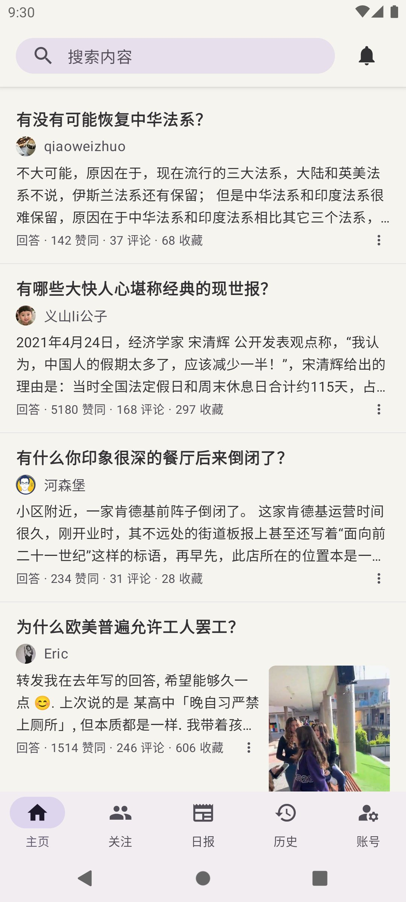
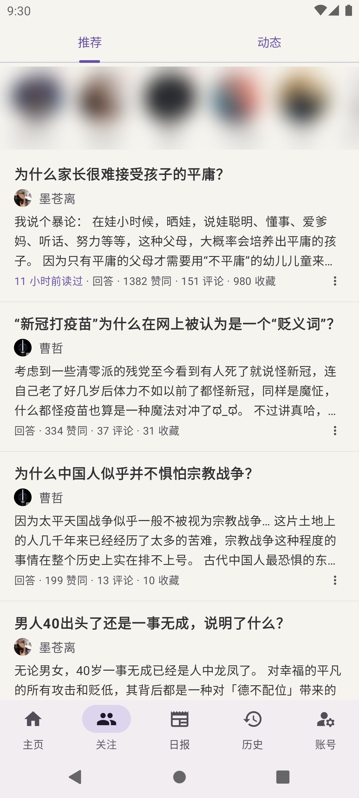
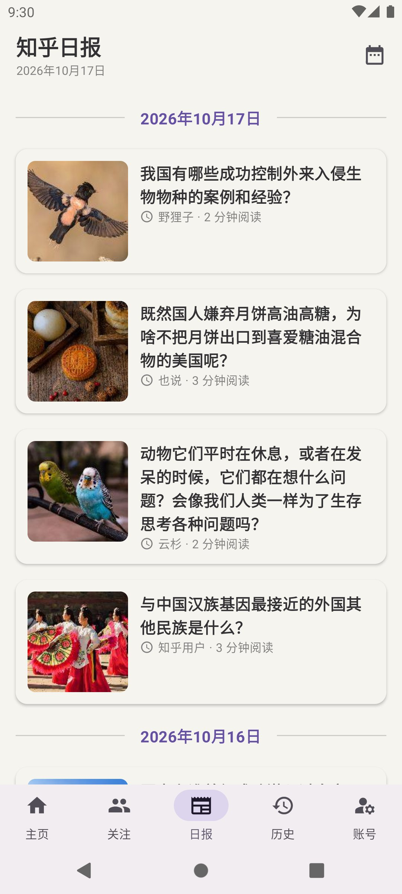
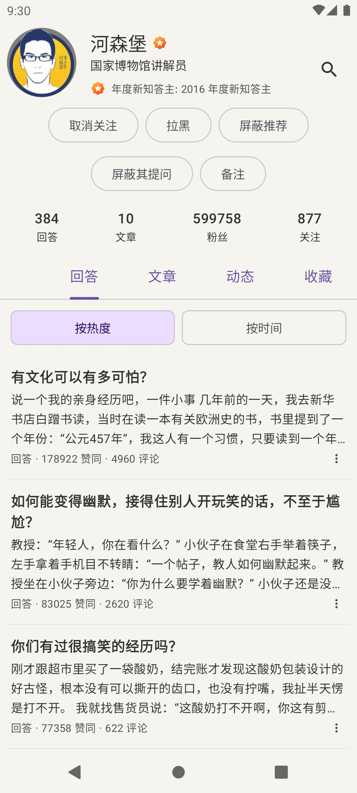
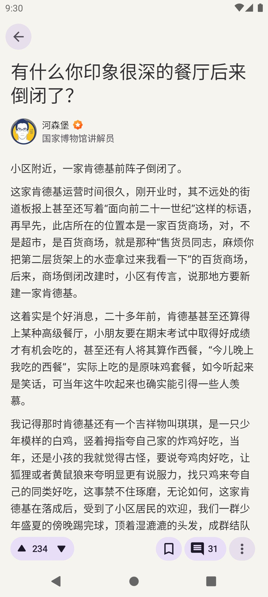

# Zhihu++：注重隐私、互联网个人权利和无广告的知乎客户端

> **本仓库是 [zly2006/zhihu-plus-plus](https://github.com/zly2006/zhihu-plus-plus) 的个人魔改分支「知乎++ Jev」**，与上游的主要区别：
>
> - 不再区分 Full / Lite，只有一个版本；包名 `com.github.zly2006.zhplus.jev`、应用名「知乎++ Jev」，可与官方知乎++ 同时安装。
> - AI 智能屏蔽改为联网调用 [TypeSafe Jev](https://typesafe.ai) 判断内容是否属于你设置的主题（用一句话描述主题即可），不再下载端侧 text2vec 模型；「按关键词屏蔽」的关键词挑选也由 Jev 完成。需要在构建时提供 TypeSafe API Key（`local.properties` 中的 `typesafe.apiKey`），Key 会打包进 APK，请勿分发自己构建的安装包。
> - 屏蔽词可设置匹配范围：全部内容 / 仅标题 / 仅作者名。
> - 离线阅读：联网时看过的回答、文章会保存在本地（保留 7 天、最多 2000 条），Wi-Fi 下同时预下载正文图片和作者头像；断网时首页列出已保存的内容，可直接打开阅读。首页每次刷新加载两页。
> - 已读标记：列表卡片上显示「3 天前读过」（同步知乎账号的浏览历史）。
> - 数据同步（设置 → 系统与更新）：把登录信息、设置、屏蔽规则、阅读记录、本地推荐偏好和屏蔽记录完整写进你选的文件，显示最近一次同步成功的时间，可立刻同步，打开应用时超过一天没同步会自动同步一次；换手机后从文件恢复。同步和恢复都是合并，不会删掉任何一边已有的数据。文件含登录凭据，请妥善保管。
> - 关闭了更新检查（上游的发布包不含这些改动）；遥测默认关闭（开启后仍上报到上游服务器）。在线通知、AIGC 标记投票仍指向上游服务器，未作改动。
> - 「按关键词屏蔽」弹窗里的 Jev 关键词建议只在点「Jev 建议」时才联网请求。
> - 界面更简洁：回答不显示段评划线；去掉首页「+」创作按钮和推荐卡片的来源标签；卡片菜单里的话题折叠成「屏蔽话题（N）」；默认关闭刷新浮动按钮和「下一个回答」按钮（回答读到底继续上拉切换，第一次会有提示），回答页底栏自动隐藏。
> - 首页 Web 端推荐每页按发布时间从新到旧排列（推荐系统与内容过滤 → 按发布时间排序，可关闭；安卓端推荐不带发布时间，不受影响）。文章页上下滑动更跟手：标题栏随正文同步收起，松手不再自动吸附。
> - 低质量内容（赞数等不达标）默认直接隐藏，所有列表都不再留「已屏蔽」占位卡；安卓推荐模式下过滤混进来的广告卡片。
> - 卡片菜单可「屏蔽问题」（该问题及其下所有回答不再出现，可在屏蔽列表中取消）；作者页可给作者加不超过 9 个字的备注，显示在首页卡片和作者页的名字右边。
> - 回答页不显示「XX 人赞同了该回答」、开头的「谢邀 @XX」和「收录」标记。
> - 断网时只提示一次「网络不可用」并显示离线内容，网络恢复后首页自动刷新。
> - 本分支没有公开发布安装包（作者自用的包只放在本地，因内含 API Key 不分发），需要自行构建：`./gradlew :app:assembleDebug`，或用 `./gradlew :app:assembleRelease` 构建更小更流畅的 release 包（需自行签名）。下文的下载链接和版本说明均为上游内容。

本项目还不够完善，欢迎PR。

Zhihu++独创本地推荐算法，把内容推荐完全放在本地进行，为您提供和筛选高质量内容。
本地推荐算法完全独立于知乎算法，依赖爬虫运行，可以自由定制各种推荐权重，保证看到自己想看的内容。
我相信，这点绵薄之力可以帮助广大用户从大公司的手中夺回本该属于我们的权利——选择自己的生活，不被算法奴役的权利。

知乎客户端，Android 为主，并提供实验性桌面版。去广告，去推广软文，去推销带货，去盐选专栏。

支持手机端/网页端/混合等多种推荐方案。

可以设置屏蔽词、AI屏蔽回答、屏蔽用户、屏蔽话题，也支持搜索筛选、沉浸式阅读、AIGC 标记和内容创作。

## 应用截图

| 首页 | 关注 | 日报 | 个人主页 | 文章 |
| --- | --- | --- | --- | --- |
|  |  |  |  |  |

  
  

    知乎++在老年机上都能流畅运行 photo by @zeky
  

## 下载

告别知乎 110MB+ 的 Android 客户端，Lite APK 只要不到 4 MB！

[点我下载](https://github.com/zly2006/zhihu-plus-plus/releases)

[下载最新开发版本](https://github.com/zly2006/zhihu-plus-plus/releases/tag/nightly)

桌面版提供 Windows MSI 安装包与 Linux AppImage（均内置 Java 运行时，下载安装即可使用，无需另外安装 Java），macOS 提供 arm64 原生应用。

> 关于Full和Lite两个版本的说明：
> Full版本包含了一个onnx框架，可以在端侧进行离线AI推理，支持基于LLM embedding的智能内容过滤功能，
> 这实际上主要是本人对端侧AI的技术尝试，实际功能还有很多没开发的，比如人本地知识库（懒）；
> Lite版本不支持智能内容过滤，但体积更小，性能更好。您可以根据自己的需求选择下载哪个版本。

## 路线图

### 已经实现的功能

- 登录与账号
  - 支持手机验证码登录
  - 支持通过扫码在电脑端登录
  - 支持手动设置 Cookie 登录
- 信息流与推荐
  - 首页推荐支持 Web / 安卓 / 本地 / 混合模式
  - 支持切换 **登录状态 / 非登录状态** 下的推荐，防止信息茧房
  - 支持关注页（推荐/动态，可显示动态来源说明）、热榜、知乎日报、搜索（含热搜、历史、排序/类型/时间筛选）
  - 支持智能内容过滤、质量过滤、反向屏蔽、过滤统计与屏蔽记录
  - **支持屏蔽知乎盐选付费内容**
- 内容浏览
  - 阅读回答
  - 阅读文章
  - 浏览问题详情页（排序、关注、日志、分享、评论）
  - 浏览想法（Pin）详情页（点赞、评论、分享、话题、投票）
  - 浏览收藏夹及收藏夹内容
  - 在用户主页内搜索 TA 的创作
  - 历史记录（在线历史 + 本地历史，支持删除）
  - 展示知乎官方认证徽章
  - 应用内播放知乎视频
- 阅读
  - 朗读内容（听文章 / 听回答）
  - 回答页长按保存图片 **无水印**
  - 回答切换手势（上下/左右切换）与”下一个回答”按钮
  - 沉浸式阅读，可隐藏回答区干扰元素
  - AI 总结内容
  - **导出内容**（PDF / 图片 / Markdown / HTML）
  - **支持导出整个收藏夹**
  - 内容划线高亮
  - 图片查看器支持动图（GIF）与多图滑动切换
  - 数学公式渲染（LaTeX，字体动态下载）
  - 支持调节正文段间距
  - 可拖动滚动条、上划/下划自动隐藏/显示操作按钮
- 内容创作
  - Android 端支持写回答、编辑已有回答、保存草稿和发布回答
  - 写回答支持 Markdown 编辑、预览和插入图片
- 社区互动
  - 支持查看个人主页（含关注订阅板块）、关注/拉黑用户、屏蔽推荐
  - 支持查看回答赞同者列表，以及关注的人赞同
  - 评论区（含子评论、回复、点赞、按时间排序）
  - 通知（支持分类、红点设置、全部标记已读、自动标记已读与通知筛选）
  - 可记名标记疑似 AIGC 内容，并查看有效标记和投票人
  - 表情包
    - 经典表情`[惊喜]`  强势回归！
- 屏蔽系统
  - 屏蔽词（支持正则表达式）
  - NLP 屏蔽词（上游：基于 LLM embedding 和向量相似度匹配，仅 full 版本可用；本分支改为 TypeSafe Jev 判断，无版本限制）
  - 屏蔽用户（含评论、问题回答等场景）
  - 屏蔽话题（含想法流）
  - **导出屏蔽词** & **导入屏蔽词**（支持跨设备迁移）
  - 屏蔽历史记录
- 其他
  - 基于 Kotlin Multiplatform 共享核心代码，支持 Android 与实验性桌面端
  - 支持 zse96 v2 签名算法（可以调用 99% 的网页端 API）
  - 支持模拟安卓端 API 调用
  - 支持 Deep Link 与剪贴板链接识别跳转
  - 支持二维码扫码结果展示和复制，可用于提取网址、Wi-Fi 密码等信息
  - 主界面支持横滑切换标签页
  - 防沉迷提醒
  - 支持自定义初始页面
  - 双击操作快速 **点赞** 或 **打开评论区**
  - 点击底部导航栏回到顶部/刷新

### 遥测

若您同意（可以在设置关闭），本应用会收集一些匿名的数据，用来统计使用量。您可以随时拒绝遥测，这不影响任何功能的使用。我们收集的数据如下：

- 应用启动次数
- 应用启动时间
- 您的IP地址
- 经过SHA256匿名化后的知乎账号ID（如果您登录了的话）

除此之外，我们不会收集任何其他数据，包括但不限于您的浏览记录、推荐算法的输入输出、屏蔽词列表等。

### See Also

如果对其他知乎客户端感兴趣，这些客户端都不需要你root即可使用，也欢迎尝试：

- [Hydrogen](https://github.com/zhihulite/Hydrogen)
- [Zhihu--](https://github.com/huamurui/zhihu-minus-minus) （极早期开发阶段，功能尚有欠缺）
- [Zhihu++ swift版（iOS）](https://github.com/kangyun1994/zhihu-plus-plus-swift)
- [Zhihu++ HMOS （鸿蒙版）](https://github.com/zhuoyi233/zhihu-plus-plus-HMOS)

注意：这里的所有项目与知乎++无关，在此列出不代表其实得到了知乎++的支持或背书。

## 贡献者

感谢所有为 Zhihu++ 做出贡献的开发者与用户，正是你们让这个项目持续变得更好。

