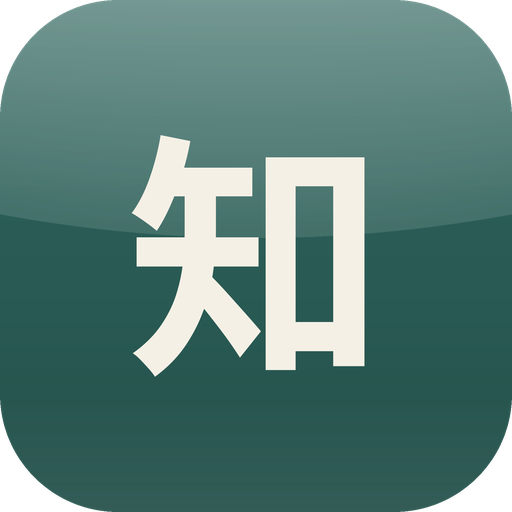

# 知乎++ Jev

**知乎++ Jev** 是 [知乎++](https://github.com/zly2006/zhihu-plus-plus) 的个人改版：一个更清爽、更安静的知乎安卓 App。

**看得舒服**
- 护眼配色，去掉多余的按钮、标签和徽章
- 回答里不再出现「谢邀」「XX 人赞同」「收录到」之类的杂项
- 首页显示收藏数、回答字数和「几天前读过」，新内容排在前面
- 读完一个回答，继续往上滑就是下一个；在正文上往右划就返回
- 你读的时候，下一批推荐已经在后台准备好，刷新几乎是瞬间的；没划到的内容不算看过，以后还会推给你

**想屏蔽什么就屏蔽什么**
- 关键词、话题、问题、用户都能屏蔽，关键词还能只查标题或作者名
- 用一句话说出不想看的主题，由 AI 帮你认出来并隐藏
- 广告、盐选付费内容、低质量内容和带认证身份的作者自动隐藏
- 首页卡片左滑就能屏蔽这个问题；评论区左滑就能屏蔽评论者；可以给作者写备注

**没网也能看，收藏能搜**
- 看过的回答和文章会存在手机里，断网时照样能读，网络恢复后自动刷新
- 收藏夹可以按关键词搜索全文，点结果直接跳到那句话
- 评论长按复制，双击收藏到手机里的一个文件

**更干净**
- 只和知乎打交道，不收集你的任何使用数据
- 所有请求都以同一个电脑浏览器的身份、走网页版的接口发出，不再同时冒充安卓 App
- 没有防沉迷提醒、更新提示和推送公告
- 设置、屏蔽规则和阅读记录可以备份到文件，换手机时恢复

## 应用截图

以下为知乎++ Jev v1.9 的实际界面，之后的版本界面有些小改动。

| 首页 | 关注 | 日报 | 个人主页 | 文章 |
| --- | --- | --- | --- | --- |
|  |  |  |  |  |

## 全部功能

- **登录**：手机验证码、扫码、手动填写 Cookie
- **首页推荐**：网页、本地两种模式；可以切换登录 / 未登录状态下的推荐，避免信息茧房。本地推荐完全在手机上进行，不依赖知乎的推荐算法，权重可以自己调
- **浏览**：回答、文章、问题、想法、收藏夹（可按关键词搜索全文）、热榜、知乎日报、搜索（热搜、历史、筛选）、浏览历史、视频
- **阅读**：保存无水印图片、上下滑切换回答、右划返回、沉浸式阅读、AI 总结（由知乎提供）、导出为 PDF / 图片 / Markdown / HTML（可以导出整个收藏夹）、数学公式、字号行距可调
- **离线**：看过的内容在手机里保存 7 天，断网也能读
- **屏蔽**：关键词（支持正则）、AI 主题、用户、话题、问题（首页卡片左滑即可）、提问者；广告、盐选付费内容、低质量内容（按赞数等）、认证身份的作者自动隐藏；屏蔽规则可以导出导入，有屏蔽记录可查
- **互动**：作者主页（关注、拉黑、屏蔽推荐、备注）、评论区（楼中楼、回复、点赞、排序，长评论自动折叠，长按复制、双击收藏）、消息通知与私信、写回答（Markdown、插图、草稿）
- **数据同步**：把设置、屏蔽规则、阅读记录完整写进你选的文件，每天自动同步一次，换手机时从文件恢复
- **界面**：护眼配色、自定义主题色和背景色、双击点赞或打开评论、点底栏切换页面和回到顶部

## 隐私

- App 只和知乎通信。没有遥测、更新检查、在线通知和崩溃上报，不会向任何其他地方发送你的使用数据。
- 唯一的例外是 AI 屏蔽：开启后，卡片的标题、摘要和正文开头（最多 3000 字）会发给你自己填写 Key 的 AI 服务（[TypeSafe](https://typesafe.ai) 或 [Cloudflare](https://dash.cloudflare.com)）来判断。
- 登录信息只保存在手机里。数据同步的备份文件包含登录信息，请妥善保管。

## AI 屏蔽需要自己的 Key

这项功能要用你自己申请的 Key：在 TypeSafe 或 Cloudflare 注册后获取（Cloudflare 每天有一定免费额度），填在「账号 → 屏蔽列表 → AI 屏蔽主题」里。不填也不影响其他功能。

## 安装

本改版不提供安装包，需要自己编译，方法见 [AGENTS.md](AGENTS.md)。想直接下载安装，可以使用原版 [知乎++](https://github.com/zly2006/zhihu-plus-plus/releases)。

## 相关项目

如果对其他知乎客户端感兴趣，这些客户端都不需要 root 即可使用：

- [知乎++](https://github.com/zly2006/zhihu-plus-plus)（本改版的原项目，支持安卓与桌面端）
- [Hydrogen](https://github.com/zhihulite/Hydrogen)
- [Zhihu--](https://github.com/huamurui/zhihu-minus-minus)（极早期开发阶段）
- [Zhihu++ swift 版（iOS）](https://github.com/kangyun1994/zhihu-plus-plus-swift)
- [Zhihu++ HMOS（鸿蒙版）](https://github.com/zhuoyi233/zhihu-plus-plus-HMOS)

以上项目与本改版无关，列出不代表得到其支持或背书。

## 致谢与许可

本改版基于 [zly2006/zhihu-plus-plus](https://github.com/zly2006/zhihu-plus-plus)，感谢原作者和所有贡献者：

本项目以 [AGPL-3.0](LICENSE) 许可证发布。分发修改后的版本时，需要同时提供源代码。本软件仅供学习交流使用，应用内内容由知乎提供，著作权归原作者所有。
